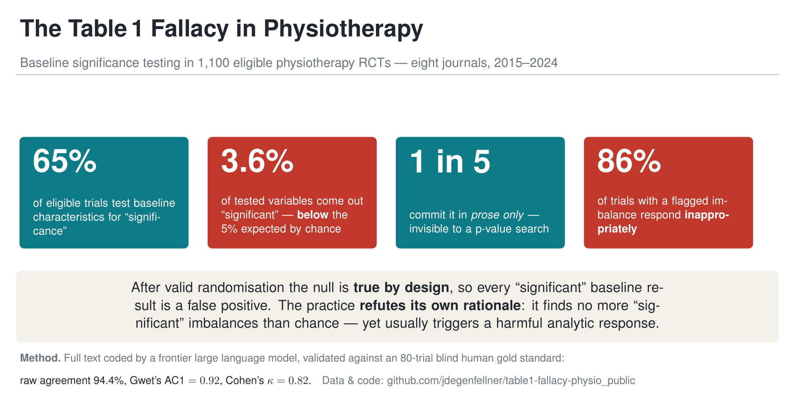

# The Enduring Table 1 Fallacy in Physiotherapy

Meta-research **census** of baseline significance testing (the "Table 1 Fallacy") in randomised
controlled trials published 2015–2024 in eight leading physiotherapy/rehabilitation journals.

**Headline findings** (revised version, October 2026; 1,634 frame records, 1,553 coded, 1,094 eligible
after excluding four retracted trials): baseline significance testing in **65.2%** of trials (99% CI
61.4 to 68.8); **3.6%** of tested baseline variables "significant" (study-level bootstrap 99% CI 2.9 to
4.4, below the 5% expected by chance); **21%** of testing trials report the test in narrative form only;
of the 173 trials with at least one "significant" variable, **33%** responded inappropriately by the human
coding (11% doubted the randomisation or discounted their results, 22% adjusted post hoc), while 39%
mentioned the difference without consequence. First-pass coding by a hosted frontier large language
model, validated against an 80-trial human reference (primary outcome: raw agreement 95.2%, Gwet's
AC1 0.93, Cohen's κ 0.84) and, for the analytic response, against a full human recoding of all 173
trials (see below). The submitted version had reported 86% inappropriate responses from the model
coding alone. The human recoding showed that the model had applied the category "randomisation
failed" to almost any mention of a "significant" difference.

## Transparency: the full trial list and the human coding

- **`data/rct_census_list.csv`** — every candidate RCT in the census frame (record ID, PMID, DOI,
  journal, **publisher**, year, title) with a **`full_text_retrieved`** flag (yes/no). This makes the
  denominator and every exclusion fully auditable.
- **`data/human_gold_coding.csv`** — the complete **human** gold-standard coding of the 80-trial
  reliability subsample (blind to the model), field by field.
- **`data/response_validation_human.csv`** — the human coding of the analytic response in all 173
  trials with at least one "significant" baseline variable (October 2026, blind to the model
  category): number of "significant" variables as counted by the rater, response category
  (none / neutral_mention / randomisation_doubted / results_discounted / selective_posthoc_adjustment /
  prespecified_adjustment / other) and the stated basis of any adjustment (significance / clinical /
  prespecified / unclear). `build_response_validation_sheet.py` built the blind coding sheet.

**Full-text availability.** Of the 1,663 candidate records, 107 could not be retrieved as
machine-readable full text. These are **not** spread evenly across publishers:

| Publisher | Records unavailable |
|---|---|
| **SAGE** (Clinical Rehabilitation) | **81** |
| Elsevier | 25 |
| BMJ | 1 |

Three-quarters of all unretrievable trials sit behind a single publisher's access barrier.

## What else is in this repo

- `PROTOCOL.md`, `CODEBOOK.md`, `PROCESS.md` — protocol, coding rules, and full-text acquisition process.
- Coding & analysis:
  - `extract.py` — the full model-agnostic extraction contract (system prompt + JSON schema) with a
    local, on-device runner (Ollama). The bulk first pass used a hosted frontier model via a separate
    runner not shipped here; the prompt and schema shown here are exactly what it was given.
  - `code_mlx.py`, `build_ensemble.py`, `build_tiebreak.py` — local open-weight ensemble + tie-break (secondary check).
  - `census_analysis.py` — prevalence, by-year, obs-vs-5%, associations, downstream (99% Wilson CIs).
  - `revision_analysis.py` — **the revised analysis (October 2026)**: reproduces every number in the
    revised manuscript (issue-year rule, retracted trials excluded, 99% Wilson intervals, study-level
    bootstrap, stratum-weighted agreement, sensitivity analyses, human validation of the analytic
    response with confusion matrix and κ). Run `python3 revision_analysis.py > analysis_numbers.md`.
  - `prior_audit_search.md` — the PubMed search for earlier audits of baseline testing (14 October 2026).
  - `agreement.py` — reliability panel: Cohen's κ, Gwet's AC1, and a detector panel vs the human gold.
- `data/` — shareable metadata and per-record coding results (no article text).

## What's NOT in this repo (by design)

Full texts and publisher PDFs are **copyrighted** and excluded via `.gitignore` (`pdftext/`, `pdfs/`,
`00_GOLD_REVIEW_80/*.pdf`, …); a global `*.pdf` ignore is a second safety net. API keys are excluded.
Everything shared is bibliographic metadata plus derived codings.

## Reproducibility & ethics

The frozen frame, codebook, human gold coding, human response coding and analysis code are archived here. Prevalence
estimates use 99% Wilson confidence intervals throughout. Meta-research on published literature; no
human-subjects approval required. The study was not pre-registered.
